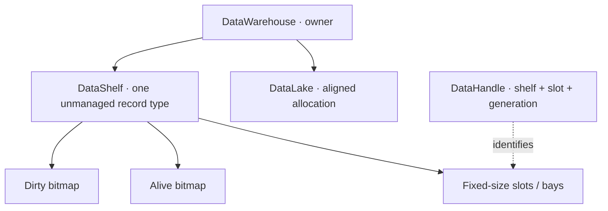

<p align="center">
  <a href="https://github.com/TrentBest/TheSingularityWorkshop.Visualize">
    
  </a>
</p>

# TheSingularityWorkshop.DataWarehouse

[](https://github.com/TrentBest/TheSingularityWorkshop.DataWarehouse/actions/workflows/tests.yml)
[](LICENSE)
[](https://github.com/TrentBest/TheSingularityWorkshop.DataWarehouse/commits/development)

**A platform-neutral, page-aligned unmanaged data store designed for direct, predictable access.**

## 00 Identity

DataWarehouse reconstructs the low-level memory technology from an earlier Unity-era implementation. Its vocabulary is physical on purpose: a **lake** owns allocation, **shelves** hold fixed-size records, **slots** are bays, and **handles** identify records across allocation lifetimes.

This is not the higher-level AEC-facing [SingularityWarehouse](https://github.com/TrentBest/SingularityWarehouse). The two projects occupy different layers and should not be conflated.

## A shelf, at a glance



*Conceptual architecture view, source-checked against the current public types. It explains ownership and tracking; it is not a memory-layout diagram or a measured performance result.*

## 01 What

DataWarehouse places fixed-size unmanaged records in aligned shelf memory. A handle identifies a shelf, slot, and generation; separate bitmaps track slot liveness and dirty state.

The core address calculation is:

`address = shelfBase + slot × sizeof(T)`

The slot calculation is constant-time in the algorithmic sense. Handle validation and memory access have real costs, and practical latency depends on CPU caches, memory topology, and workload.

## 02 Why

General-purpose object graphs and hash lookups are convenient, but may introduce indirection and per-object overhead in hot paths. DataWarehouse explores a more explicit trade-off: fixed-size records, predictable slot addressing, and lifecycle metadata kept outside the record payload.

The goal is not to declare every workload faster. The goal is to make the storage model measurable and to establish where it helps.

## 03 How

- **Data Lake** — aligned unmanaged allocation boundary.
- **DataWarehouse** — owns the lake and creates shelves.
- **Data Shelf** — page-aligned storage for one unmanaged record type.
- **Slot / bay** — one fixed-size record position.
- **Alive tracker** — external bitmap for allocated slots.
- **Dirty tracker** — external bitmap for changed or pending slots.
- **Data handle** — shelf identity + slot index + generation; supports constant-time validation and stale-handle rejection.

Current implementation includes aligned allocation, free-stack allocation/reclamation, alive and dirty bitmaps, generation-checked handles, dirty-slot enumeration into caller-provided memory, deterministic disposal, and unit tests.

It does **not** currently promise thread-safe concurrent mutation, variable-size allocation, persistence, serialization, compaction, GPU interop, or general-purpose object-database behavior.

## 04 See it in a minute

Requires the .NET 8 SDK.

```csharp
using TheSingularityWorkshop.DataWarehouse;

struct AgentState
{
    public int Mode;
    public float X;
    public float Y;
}

using var warehouse = new DataWarehouse(defaultPageSize: 4096);
var agents = warehouse.CreateShelf<AgentState>(capacity: 100_000);

if (!agents.TryAllocate(out var handle))
    throw new InvalidOperationException("No free slots.");

agents.GetRef(handle).Mode = 2; // Mutable access marks the slot dirty.
agents.GetRef(handle).X = 12.5f;

ref readonly var state = ref agents.Read(handle);
Console.WriteLine(state.Mode);

agents.MarkClean(handle); // Acknowledge processing.
agents.TryFree(handle);   // Reclaims the slot; old handles become invalid.
```

Run the tests:

```sh
dotnet test tests/TheSingularityWorkshop.DataWarehouse.Tests/TheSingularityWorkshop.DataWarehouse.Tests.csproj -c Release
```

The [DataWarehouse benchmark laboratory](https://github.com/TrentBest/TheSingularityWorkshop.Benchmarks.DataWarehouse) measures named access and lifecycle workloads. Check its reports before drawing performance conclusions.

## 05 Available documentation and theory

- [Documentation inventory and diagram status](docs/DocumentationInventory.md)
- [DataShelf API and operational contract](docs/api/DataShelf.md)
- [DataShelf lifecycle sequence](docs/UML/DataShelf-Lifecycle.md)
- [Source code](src/TheSingularityWorkshop.DataWarehouse/)
- [Unit tests](tests/TheSingularityWorkshop.DataWarehouse.Tests/)
- [Benchmark laboratory](https://github.com/TrentBest/TheSingularityWorkshop.Benchmarks.DataWarehouse)
- [SingularityWarehouse — higher-level AEC data fabric](https://github.com/TrentBest/SingularityWarehouse)

## Design boundary and verification

This repository owns low-level memory layout, slot lifecycle, and direct access. It does not require Unity, FSM_COS, MicroBundleDomain, Ontology, or a UI framework. Complexity statements describe algorithmic structure, not guaranteed wall-clock speed; benchmark claims must name their workload and environment.

<p align="center"></p>
