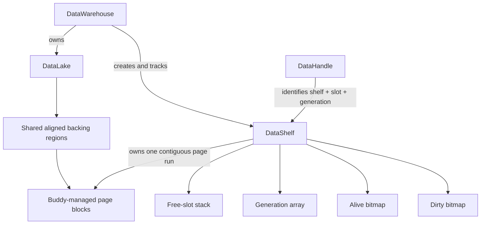

<p align="center"><a href="https://github.com/TrentBest/TheSingularityWorkshop.Visualize"></a></p>

# DataWarehouse — architecture and domain model

## 00 Identity

DataWarehouse is a low-level, in-process storage library for fixed-size unmanaged records. Its domain is the controlled lifecycle of record storage: reserve memory, address slots, identify live records, track changes, reclaim slots, grow typed capacity, and release allocations.

This document defines the vocabulary and responsibility boundaries of the implemented storage model. It does not describe a database, persistence engine, or application service.

## 01 Domain vocabulary

| Term | Meaning | Current representation |
|---|---|---|
| Warehouse | Aggregate owner and shelf factory | `DataWarehouse` |
| Lake | Shared backing regions, page allocation/reclamation, and byte accounting | `DataLake` |
| Region | One aligned native backing allocation divided into buddy-managed page blocks | `DataLakeRegion` |
| Shelf | Dynamically growable typed slot space backed by one contiguous page run at a time | `DataShelf<T>` |
| Record | One fixed-size `T` payload | `sizeof(T)` bytes |
| Slot / bay | One position in a shelf | Integer index from `0` through `Capacity - 1` |
| Handle | Validated identity for a live slot incarnation | `DataHandle(ShelfId, Slot, Generation)` |
| Shelf identity | Process-local identifier distinguishing shelves | Monotonically assigned positive integer |
| Generation | Incarnation counter for a slot | Positive integer per slot |
| Alive state | Whether a slot currently contains an allocated record | External bitmap |
| Dirty state | Whether a slot requires downstream processing/acknowledgement | External bitmap |
| Free stack | Available slot indexes | Managed integer array + count |
| Allocation extent | Power-of-two buddy block assigned to a shelf | Region/start-page/order allocation token |

A handle is a storage identity, not an object reference, authorization token, persistence key, or globally stable identifier.

## 02 Ownership topology



The lake owns native backing regions shared by multiple shelves. It allocates contiguous page blocks from those regions with a buddy allocator; it does not own shelf metadata or understand records. Each shelf owns one active page-run allocation token and its managed slot metadata. The warehouse tracks created shelves so aggregate disposal can release every page run before closing the lake.

## 03 Public type responsibilities

### DataWarehouse

- Creates the shared `DataLake` with configured base page and normal region sizes.
- Exposes the lake, default page size, and default region size.
- Creates typed shelves with initial capacity and optional per-shelf alignment override.
- Tracks active shelves in a linked ownership list and exposes the active `ShelfCount`.
- Individually disposed shelves unregister immediately, avoiding retention of every shelf ever created.
- Disposes registered shelves in reverse creation order, then closes the lake.
- Rejects new shelf creation after disposal.

Shelf creation is exception-conscious: if warehouse disposal wins the creation race, the just-created shelf is disposed before an exception is raised. If adding the shelf to the warehouse's managed ownership list fails, the shelf is also disposed before the original failure is rethrown.

It does not provide record lookup by key, transactions, schema evolution, or query execution.

### DataLake

- Owns one or more aligned native backing regions.
- Suballocates contiguous power-of-two page blocks through per-region buddy free lists.
- Splits larger blocks on allocation and coalesces free buddies on reclamation.
- Clears every allocated block before returning it, preventing stale bytes from a prior allocation lifetime.
- Tracks active shelf-allocation bytes separately from reserved native-region bytes.
- Retains free regions for reuse and releases them after disposal once the final shelf returns its pages.
- Serializes region allocation/reclamation and lake disposal without locking record access.

It does not interpret record types, handles, alive/dirty state, or domain meaning.

### DataShelf<T>

- Stores one unmanaged record type in contiguous fixed-size slots within its current page run.
- Uses `base + slot × sizeof(T)` addressing.
- Allocates and frees slots through a LIFO free stack.
- Validates handles using shelf identity, bounds, generation, and alive state.
- Tracks alive and dirty state in separate bitmaps.
- Returns mutable refs through `GetRef` and read-only refs through `Read`.
- Enumerates dirty slot indexes into caller-owned memory and resolves current live handles with `TryGetHandle`.
- Grows with `EnsureCapacity`, allocating a replacement page run and preserving record bytes, handles, generations, and side-band state.
- Returns its page-run allocation to the lake on disposal.

### DataHandle and ShelfIdentity

`DataHandle` is a compact immutable value containing shelf identity, slot index, and generation. `ShelfIdentity` supplies monotonically increasing process-local IDs and fails rather than wrapping when the integer space is exhausted.

## 04 Addressing and memory layout

For a slot `i` in a shelf:

```text
recordAddress(i) = baseAddress + i * sizeof(T)
```

The shelf requests `capacity × sizeof(T)` bytes from the lake. The buddy allocator assigns a power-of-two block of base pages large enough for both the payload and requested alignment. The allocation base is aligned; individual records are not separately padded to page or cache-line boundaries. A record may span more than one page. The buddy block may include internal padding beyond the requested payload.

Record payloads are unmanaged and contiguous. Free-stack entries, generations, alive bits, and dirty bits are side-band metadata; they are not stored inside `T`.

The current metadata cost is approximately:

- `capacity × sizeof(int)` bytes for free-slot indexes;
- `capacity × sizeof(int)` bytes for generations;
- `ceil(capacity / 64) × sizeof(ulong)` bytes for alive bits;
- the same bitmap size for dirty bits;
- array headers and alignment overhead managed by the CLR.

This excludes object headers, allocator metadata, and buddy-block padding. It is a structural estimate, not a measured footprint. Growth temporarily holds both old and replacement page runs while copying.

## 05 Allocation and growth

A new shelf initializes its managed slot metadata before requesting native pages. The lake finds or creates a shared region, allocates a buddy block, and clears it before returning it.

`EnsureCapacity(minimumCapacity)` is a controlled relocation operation:

1. Reject disposed shelves and non-positive requested capacity; do nothing when current capacity is already sufficient.
2. Allocate replacement free-stack, generation, alive, and dirty arrays.
3. Allocate a replacement page run from the lake.
4. Copy the previous payload bytes into the zeroed replacement block.
5. Append new slot indexes to the free stack and initialize their generations to 1.
6. Commit the new pointer, allocation token, metadata arrays, and capacity.
7. Return the old page run to the lake.

Existing handles remain valid because shelf identity, slot indexes, and generations are preserved. Any ref or raw address obtained before growth becomes invalid. The caller must ensure exclusive, quiescent access and stop using all outstanding refs and addresses before calling `EnsureCapacity`.

Growth may temporarily require enough free lake pages for both old and new blocks. The lake may create another region if existing free blocks cannot satisfy the replacement request.

## 06 Slot lifecycle and dirty state

1. Shelf creation initializes every slot generation to 1 and all alive/dirty bits to false.
2. `TryAllocate` pops a free slot, marks it alive and dirty, clears its record bytes, and returns a generation-checked handle.
3. `GetRef` validates the handle and marks dirty before exposing a mutable ref.
4. `Read` validates the handle but does not change dirty state.
5. `MarkClean` clears dirty state as an acknowledgement.
6. `TryFree` clears alive and dirty state, decrements counters, advances generation, and returns the slot to the free stack.
7. A slot at generation `int.MaxValue` is retired instead of being returned to the free stack.
8. Shelf growth preserves existing payload and side-band state but invalidates old refs and addresses.
9. Shelf disposal returns its page run once. Warehouse disposal performs this for every registered shelf before closing the lake.

Dirty means “this slot is currently marked for processing.” It is not a write journal, event stream, or delivery guarantee. The shelf cannot observe writes made later through an already-returned ref. `CopyDirtySlots` copies indexes only; it does not clear bits or create a stable snapshot under concurrent mutation.

## 07 Accounting and fragmentation

| Metric | Meaning |
|---|---|
| `DataLake.AllocatedBytes` | Buddy-block bytes currently assigned to live shelves, including block rounding |
| `DataLake.ReservedBytes` | Total native backing-region bytes |
| `DataLake.FreeBytes` | Reserved bytes not assigned to live shelf blocks |
| `DataLake.RegionCount` | Number of retained native regions |
| `DataShelf<T>.AllocatedBytes` | Current buddy-block extent for this shelf; retained as a size diagnostic after disposal |

Free bytes are not necessarily one contiguous allocation. Buddy fragmentation may prevent a request from using the total free byte count, even when enough bytes are free in aggregate.

## 08 Concurrency and lifetime

A shelf is not thread-safe for concurrent mutation. Its free stack, counters, generations, and bitmaps are ordinary mutable state. The performance model is independent shelf ownership: assign separate shelves to workers, or externally synchronize shared access.

Lake page allocation/reclamation is synchronized separately from record access. This keeps allocator coordination out of per-record reads and writes.

Returned refs and `BaseAddress` can outlive the method that exposed them. No method-level lock can make an escaped ref safe after growth or disposal. The caller must ensure that all refs and raw addresses are no longer used before growing, freeing, or disposing a shelf.

If the lake is disposed while shelves remain active, it rejects new allocations but retains backing regions until the final shelf returns its page run.

## 09 Deliberate non-goals

The current domain does not include:

- Variable-size records, strings, blobs, or arbitrary object graphs.
- Key/value indexes, queries, joins, transactions, or relational semantics.
- Serialization, persistence, snapshots, crash recovery, replication, or durability.
- Individual-record relocation, compaction, or automatic background resizing.
- Internal work queues, subscriptions, change journals, or event delivery.
- Lock-free shared-shelf mutation or automatic worker scheduling.
- Authentication, authorization, encryption, or security policy.
- Unity types, FSM_COS, MicroBundleDomain, Ontology, or UI dependencies.

Shelf-capacity growth is implemented, but it relocates the shelf's contiguous page run and requires quiescent access. These boundaries keep DataWarehouse focused on memory and record lifecycle primitives.

## 10 Boundary with the wider Workshop

- FSM_COS may compose security, scheduling, and application-level storage abstractions above it.
- DataWarehouse does not enforce FSM_COS security policy.
- SingularityWarehouse may coordinate DataWarehouse with other sources and higher-level semantics.
- SURPS documents warehouse/data-center settings and scenarios; those books do not define this library's allocator or API contract.

<p align="center"></p>
