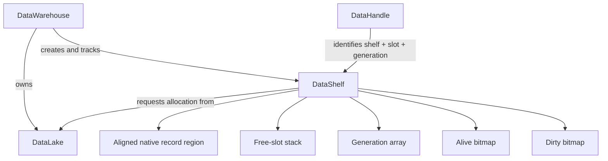

<p align="center"><a href="https://github.com/TrentBest/TheSingularityWorkshop.Visualize"></a></p>

# DataWarehouse — architecture and domain model

## 00 Identity

DataWarehouse is a low-level, in-process storage library for fixed-size unmanaged records. Its domain is the controlled lifecycle of record storage: reserve memory, address slots, identify live records, track changes, reclaim slots, and release allocations.

This document defines the vocabulary and responsibility boundaries of the current implementation. It does not describe a future database, persistence engine, or application service.

## 01 Domain vocabulary

| Term | Meaning | Current representation |
|---|---|---|
| Warehouse | Aggregate owner and shelf factory | `DataWarehouse` |
| Lake | Native allocation boundary and byte accounting | `DataLake` |
| Shelf | Fixed-capacity region for one unmanaged type | `DataShelf<T>` |
| Record | One fixed-size `T` payload | `sizeof(T)` bytes |
| Slot / bay | One position in a shelf | Integer index from `0` through `Capacity - 1` |
| Handle | Validated identity for a live slot incarnation | `DataHandle(ShelfId, Slot, Generation)` |
| Shelf identity | Process-local identifier distinguishing shelves | Monotonically assigned positive integer |
| Generation | Incarnation counter for a slot | Positive integer per slot |
| Alive state | Whether a slot currently contains an allocated record | External bitmap |
| Dirty state | Whether a slot requires downstream processing/acknowledgement | External bitmap |
| Free stack | Available slot indexes | Managed integer array + count |
| Allocation extent | Rounded native byte reservation for a shelf | `nuint` stored as shelf allocation size |

A handle is a storage identity, not an object reference, authorization token, persistence key, or globally stable identifier.

## 02 Ownership topology



The lake is an allocation service; it does not own the shelf's metadata or understand records. Each shelf owns one independent native allocation and its managed metadata arrays. The warehouse tracks created shelves so aggregate disposal can release them.

## 03 Public type responsibilities

### DataWarehouse

- Validates the default page-size setting.
- Exposes the lake and configured default page size.
- Creates typed shelves with fixed capacity and optional per-shelf page-size override.
- Tracks created shelves.
- Disposes registered shelves in reverse creation order, then closes the lake.
- Rejects new shelf creation after disposal.

It does not provide record lookup by key, transactions, schema evolution, or query execution.

### DataLake

- Allocates aligned, zeroed native memory.
- Tracks total rounded allocation bytes.
- Rejects allocations after disposal.
- Releases exact pointer/extent pairs supplied by shelves.

It does not suballocate records within one shared arena or reclaim individual slots.

### DataShelf<T>

- Stores one unmanaged record type in contiguous fixed-size slots.
- Uses `base + slot × sizeof(T)` addressing.
- Allocates and frees slots through a LIFO free stack.
- Validates handles using shelf identity, bounds, generation, and alive state.
- Tracks alive and dirty state in separate bitmaps.
- Returns mutable refs through `GetRef` and read-only refs through `Read`.
- Enumerates dirty slot indexes into caller-owned memory.
- Owns and releases its native allocation.

### DataHandle and ShelfIdentity

`DataHandle` is a compact immutable value containing shelf identity, slot index, and generation. `ShelfIdentity` supplies monotonically increasing process-local IDs and fails rather than wrapping when the integer space is exhausted.

## 04 Addressing and memory layout

For a slot `i` in a shelf:

```text
recordAddress(i) = baseAddress + i * sizeof(T)
```

The shelf requests `capacity × sizeof(T)` bytes, then rounds the allocation extent to a multiple of the configured page-size alignment. The allocation base is aligned; individual records are not separately padded to page or cache-line boundaries. A record may span more than one configured page-size unit.

Record payloads are unmanaged and contiguous. Free-stack entries, generations, alive bits, and dirty bits are side-band metadata; they are not stored inside `T`.

The current metadata cost is approximately:

- `capacity × sizeof(int)` bytes for free-slot indexes;
- `capacity × sizeof(int)` bytes for generations;
- `ceil(capacity / 64) × sizeof(ulong)` bytes for alive bits;
- the same bitmap size for dirty bits;
- array headers and alignment overhead managed by the CLR.

This excludes object headers, allocator overhead, and the native allocation's rounded padding. It is a structural estimate, not a measured footprint.

## 05 Lifecycle model

1. Warehouse creates a shelf.
2. Shelf allocates metadata arrays and initializes every generation to 1.
3. Lake reserves and clears the rounded native extent.
4. Allocation pops a slot, marks it alive and dirty, clears its record bytes, and returns a handle.
5. Mutable access validates the handle and marks dirty before exposing a ref.
6. Read-only access validates the handle but does not change dirty state.
7. A consumer acknowledges processing with `MarkClean`.
8. Free clears alive and dirty state, decrements counters, advances generation, and returns the slot to the free stack.
9. A slot at generation `int.MaxValue` is retired instead of being returned to the free stack.
10. Shelf disposal releases the native allocation once; warehouse disposal performs this for every registered shelf before closing the lake.

## 06 Dirty state is a signal, not a journal

Dirty means “this slot is currently marked for processing.” It does not mean the shelf records every write, retains a history, or guarantees delivery to a consumer.

- New allocations begin dirty.
- `GetRef` marks dirty before returning the mutable reference.
- The shelf cannot observe writes made later through an already-returned ref.
- `MarkClean` acknowledges the current dirty state.
- A later `GetRef` marks the slot dirty again.
- Freeing a dirty slot clears its dirty bit.
- `CopyDirtySlots` copies slot indexes only; it does not clear bits or establish a stable snapshot under concurrent mutation.

Consumers must own the scheduling, acknowledgement, retry, and synchronization policy above this library.

## 07 Concurrency and lifetime

The current shelf is not thread-safe for concurrent mutation. Its free stack, counters, generations, and bitmaps are ordinary mutable state. The intended performance model is independent shelf ownership: assign separate shelves to workers, or externally synchronize shared access.

Returned refs and `BaseAddress` can outlive the method that exposed them. No method-level lock can make an escaped ref safe after disposal. The caller must ensure that all refs and raw addresses are no longer used before freeing or disposing a shelf.

## 08 Deliberate non-goals

The current domain does not include:

- Variable-size objects, strings, blobs, or arbitrary object graphs.
- Key/value indexes, queries, joins, transactions, or relational semantics.
- Serialization, persistence, snapshots, crash recovery, replication, or durability.
- Shared-arena suballocation, relocation, compaction, or automatic growth.
- Internal work queues, subscriptions, change journals, or event delivery.
- Internal locks, lock-free shared mutation, or automatic worker scheduling.
- Authentication, authorization, encryption, or security policy.
- Unity types, FSM_COS, MicroBundleDomain, Ontology, or UI dependencies.

These may be composed above DataWarehouse or considered as separate future domains. They are not implied by the word “warehouse.”

## 09 Boundary with the wider Workshop

DataWarehouse owns memory and record lifecycle primitives. It should remain independently usable and dependency-light.

- FSM_COS may compose security, scheduling, and application-level storage abstractions above it.
- DataWarehouse does not enforce FSM_COS security policy.
- SingularityWarehouse may coordinate DataWarehouse with other sources and higher-level semantics.
- SURPS documents warehouse/data-center settings and scenarios; those books do not define this library's allocator or API contract.


<p align="center"></p>
