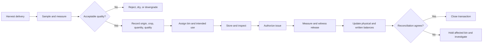
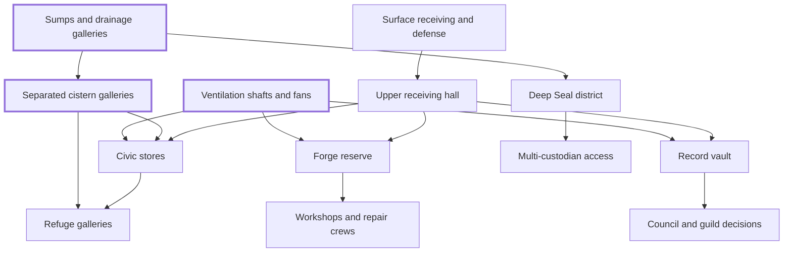
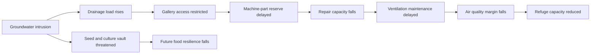
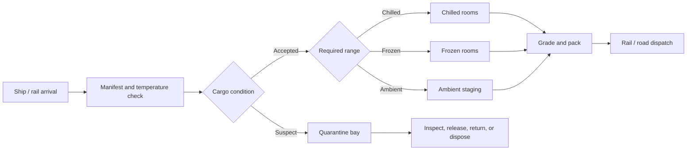
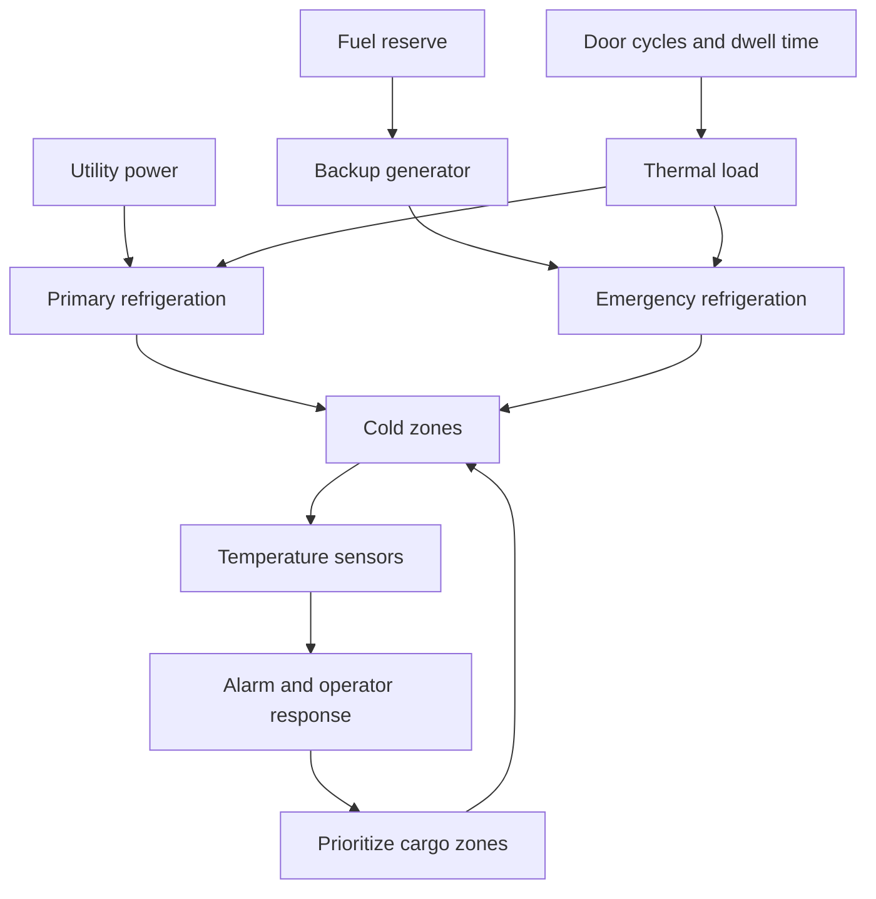
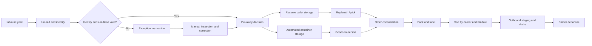
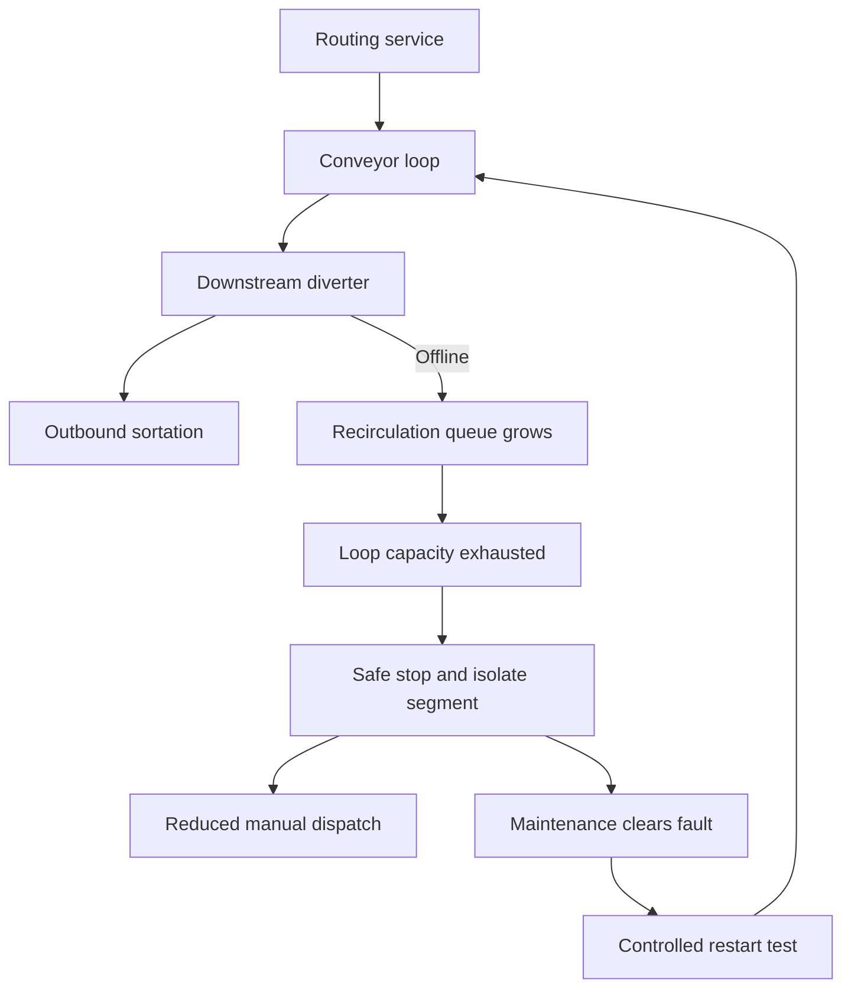
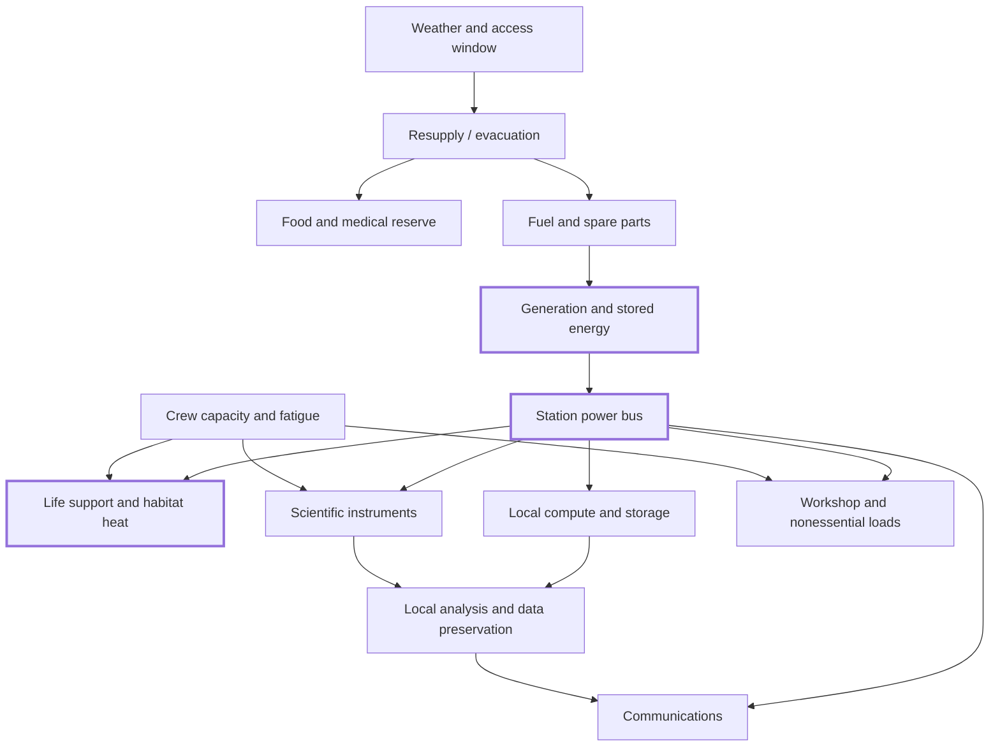
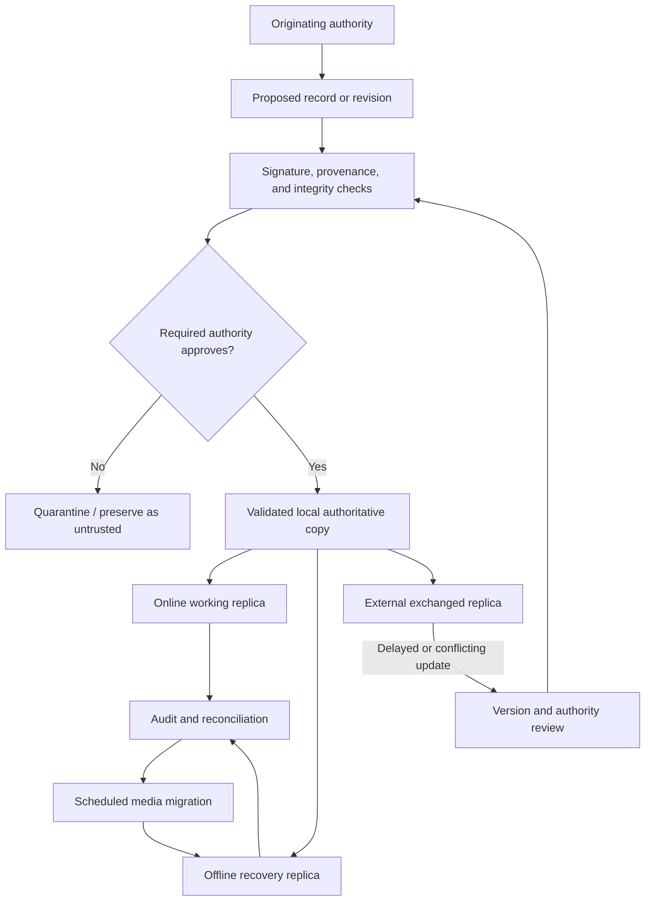

# SURPS Facility Diagrams — Plans, Flows, and Dependencies

  

**SURPS visual supplement · LOD 3–4 · Static, authored Mermaid diagrams**

> **Accuracy note:** These are conceptual diagrams for the constructed sites in the Facility Atlas. They are not measured architectural drawings, engineering plans, evacuation certifications, or claims about real historical facilities. Arrows indicate a modeled relationship or flow, not a guaranteed physical route.

## 1. Diagram conventions

- **Zones** are spaces with a distinct operational purpose.
- **Flows** show movement of goods, people, information, energy, or authority.
- **Dependencies** show services or conditions required for another function to operate.
- **Control points** are places where custody, authorization, inspection, or safety decisions occur.
- **Failure propagation** shows how a local fault can affect downstream functions.
- Solid arrows represent ordinary modeled flow; dashed arrows represent oversight, authorization, or information feedback.

Use separate diagrams for physical movement and authority. A single diagram that tries to show every relationship becomes unreadable and hides important distinctions.

## 2. Namar Granary — compound plan and stock flow

### Conceptual compound plan

The plan emphasizes separation between receiving and issue, distinct seed and food stocks, and public witness points.

```mermaid
flowchart TB
    RIVER["Canal landing"] --> RG["Receiving gate"]
    ROAD["Harvest road"] --> RG
    subgraph COMPOUND["Raised granary compound"]
      RG --> RC["Receiving court"]
      RC --> TP["Tally porch"]
      TP --> DY["Drying yard"]
      DY --> Q{"Quality accepted?"}
      Q -->|No| REJ["Reject / re-dry / investigate"]
      Q -->|Yes| SPLIT{"Assign stock purpose"}
      SPLIT --> SEED["Seed store"]
      SPLIT --> FOOD["Food-grain bins"]
      SPLIT --> INST["Institutional reserve"]
      SEED --> AUD["Steward + scribe reconciliation"]
      FOOD --> AUD
      INST --> AUD
      AUD --> IC["Issue court"]
      IC --> HH["Household allotments"]
      IC --> ER["Emergency ration issue"]
      WR["Watch room"] -. "gate and seal custody" .-> RG
      WR -. "witnessed access" .-> IC
    end
```

### Intake, storage, and issue

**Scenario levers:** drying-yard capacity, rain exposure, accepted yield, pest loss, seed reserve threshold, issue rate, and ledger discrepancy.

## 3. Deep Ledger of Khar-Dûm — vertical districts and life-support dependencies

This cross-section treats the vault as an inhabited infrastructure system. The deeper chambers are not automatically safer: they may be harder to ventilate, drain, inspect, or reach.

### Dependency and failure propagation

**Scenario levers:** water ingress, sump capacity, air quality, gallery access, reserve days, repair labor, and authority to open restricted passages.

## 4. North Quay Cold-Chain Exchange — cargo path and thermal control

### Cargo path

### Thermal service dependency

**Scenario levers:** compressor availability, backup coverage, door-open duration, temperature excursion time, cargo sensitivity, and dispatch delay.

## 5. Meridian Fulfillment Campus — material flow and exception handling

### Failure isolation

**Scenario levers:** order arrival rate, conveyor utilization, exception frequency, diverter availability, manual dispatch capacity, staffing, and carrier cut-off times.

## 6. Asterion Polar Edge Station — autonomy and essential-load hierarchy

**Operating rule:** when energy margin falls, the station sheds loads according to an explicit priority policy. Life support and safe habitat conditions outrank scientific throughput. A communication outage does not imply local data loss if local storage and power remain healthy.

**Scenario levers:** energy reserve, thermal margin, crew fatigue, instrument calibration, weather window, communication latency, and days of autonomy.

## 7. Selene Archive One — provenance and replica authority

A later timestamp is not sufficient authority. The scenario must distinguish recency, integrity, provenance, approval, and local operational validation.

**Scenario levers:** replica lag, signature-chain completeness, approval quorum, local validation state, media integrity, and communication delay.

## 8. Reusable diagram checklist

Before publishing a facility diagram, check:

- **Purpose:** does the diagram answer one clear question?
- **Boundary:** is the facility boundary explicit?
- **Direction:** are flow arrows directional and meaningful?
- **Custody:** does it show who accepts, authorizes, moves, or releases an asset?
- **Dependencies:** are power, water, climate, transport, staffing, and information dependencies visible where relevant?
- **Failure:** can a reader see at least one plausible fault path?
- **LOD:** is detail appropriate to the selected level?
- **Evidence:** are constructed values labeled, and are historical claims sourced separately?
- **Separation:** does the diagram describe the SURPS domain rather than imply an implemented DataWarehouse API?

## 9. Relationship to DataWarehouse implementation

These are domain diagrams for SURPS settings. They do not specify the .NET library's allocator, page layout, record representation, concurrency guarantees, persistence format, or API. The software repository's source and tests remain authoritative for those behaviors.

  

