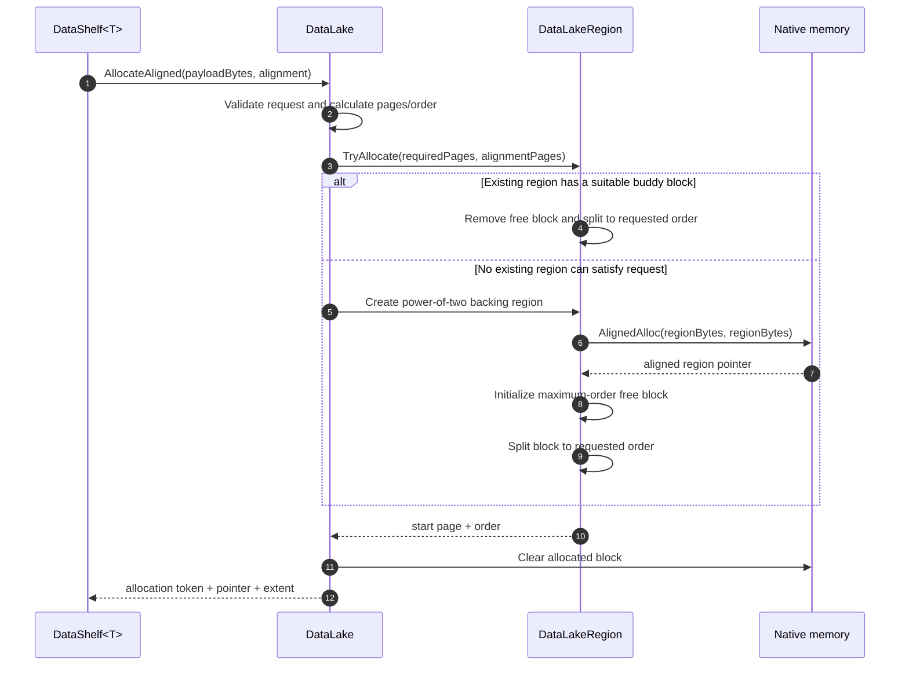
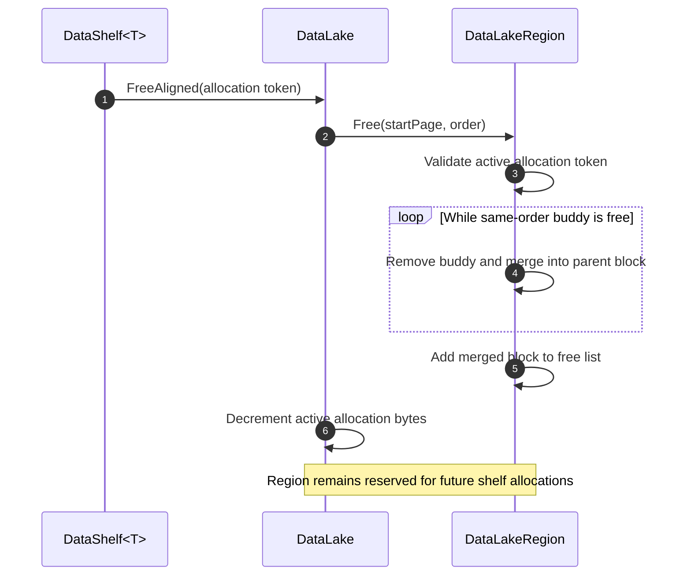

# UML — DataLake shared region and buddy-page lifecycle

## 00 Identity

This diagram documents the current DataLake page allocator: backing-region creation, buddy splitting, allocation clearing, reclamation, coalescing, reuse, and deferred disposal. It is source-checked against `DataLake.cs` on `development`.

## 01 Region allocation

## 02 Reclamation and buddy coalescing

## 03 Deferred lake disposal

- Disposing an open lake closes it to new allocations.
- If active shelf allocations remain, backing regions stay allocated and existing shelves remain usable.
- Each shelf returns its page run through normal disposal.
- When active allocation bytes reach zero, the disposed lake releases all retained native regions.
- Disposing a warehouse first disposes its registered shelves, then disposes the lake.

## 04 Allocator invariants

- Every region has a power-of-two page count.
- Every free block belongs to exactly one order-specific free list.
- Every live allocation is recorded by its start page and order.
- A live block is absent from all free lists.
- Splitting preserves total page coverage.
- Coalescing merges only a free buddy of the same order.
- No region is released while it still has live page allocations.
- Every new allocation block is cleared before it is exposed to a shelf.

## 05 Evidence and limits

- The buddy allocator uses order-specific hash sets and a live allocation map.
- Allocation searches existing regions, then searches free lists from the required order upward.
- Allocation/reclamation is serialized by the lake gate; record access is not.
- This is a source-checked static diagram, not generated output or a benchmark.

